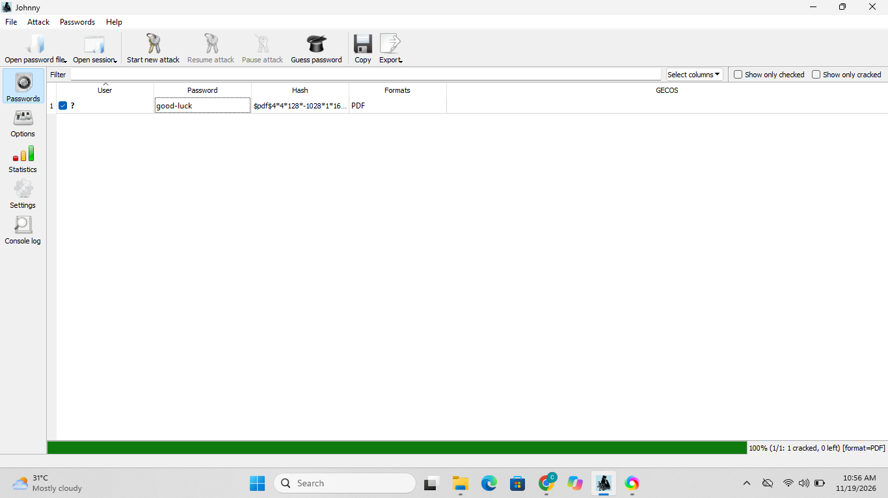
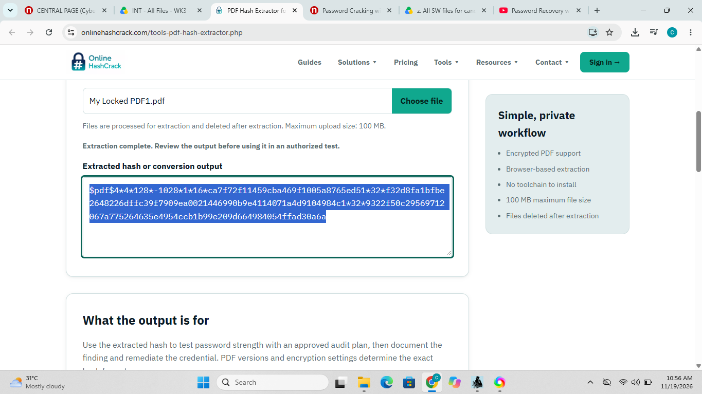
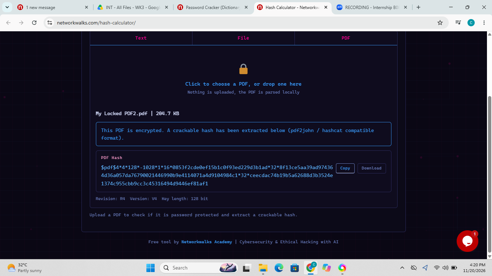
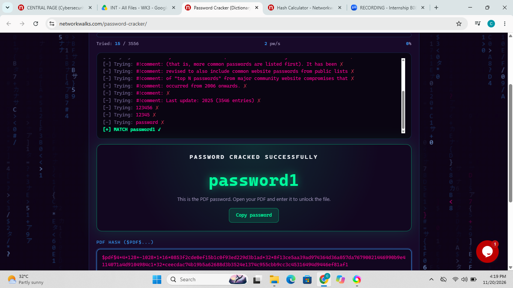
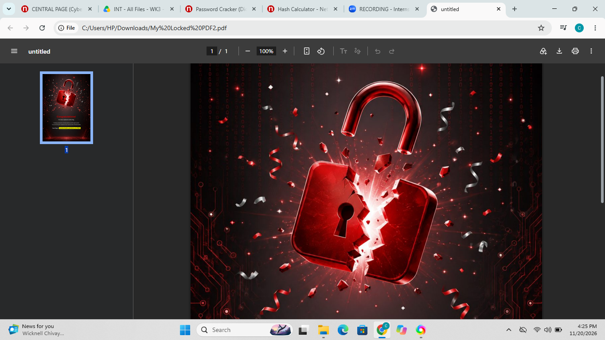
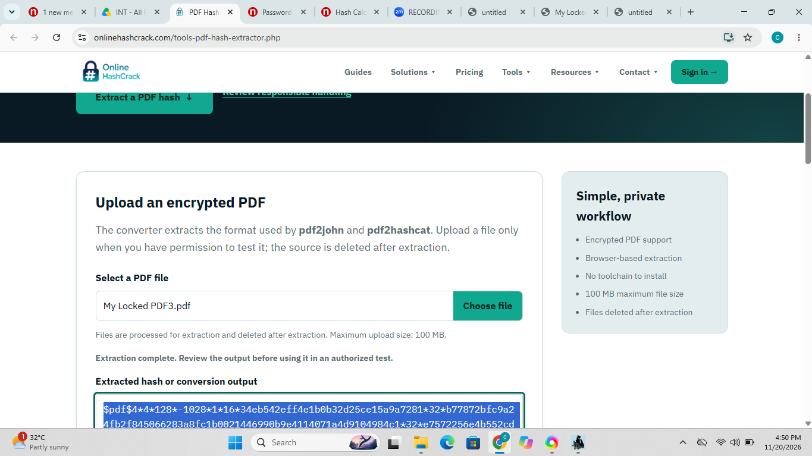
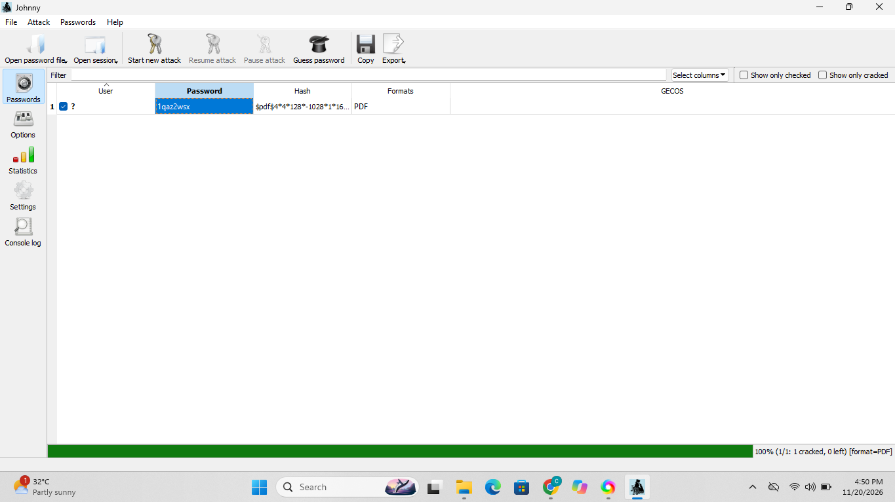

Password Cracking Using John the Ripper and Networkwalks 

1. Introduction

This project documents a hands-on cybersecurity lab exercise focused on password security and password-cracking techniques using John the Ripper and Networkwalks.

The exercise provided practical exposure to password assessment, security testing, and understanding the importance of strong password protection.

2. Tools Used

- John the Ripper (JtR): An open-source password security auditing and password recovery tool.
- Networkwalks free password-cracking tool: A tool used for password-cracking and for security exercises.

3. Activities Performed

During this exercise, I carried out the following activities:

- Explored password-cracking concepts and techniques.
- Worked with John the Ripper.
- Used the available tools to perform password-cracking exercises on provided lab challenges.
- Observed and analyzed the results obtained.
- Captured screenshots to document the practical activities.

4. Steps Taken

The practical exercise involved the following stages:

Step 1: Lab Preparation
Prepared the testing environment and identified the tools required for the exercise.

Step 2: Tool Familiarization
Explored the interfaces and functionalities of John the Ripper and Networkwalks.

Step 3: Password Assessment
Worked with the provided lab password samples and carried out the assigned password-cracking exercises.

Step 4: Result Analysis
Observed the results generated by the tools and examined the outcomes of the exercises.

Step 5: Documentation
Captured screenshots of the practical activities and organized the evidence for documentation.

5. Evidence Collected

This section contains screenshots documenting the practical exercises, tools used, and results obtained.

Evidence 1: John the Ripper

Screenshot showing the John the Ripper practical exercise.

Evidence 2: Networkwalks 

Screenshot showing the Networkwalks exercise.

Evidence 3: Exercise Results

Screenshots showing the results obtained during the 3rd password-cracking activity using John the Ripper.

6. Key Takeaways

This exercise improved my understanding of password security, password assessment, and the importance of using strong authentication practices.

It also provided practical exposure to cybersecurity tools and strengthened my ability to interpret results from security-testing activities.

7. Disclaimer

All activities documented in this repository were carried out strictly for educational purposes within an authorized lab environment. No unauthorized systems or accounts were targeted.
